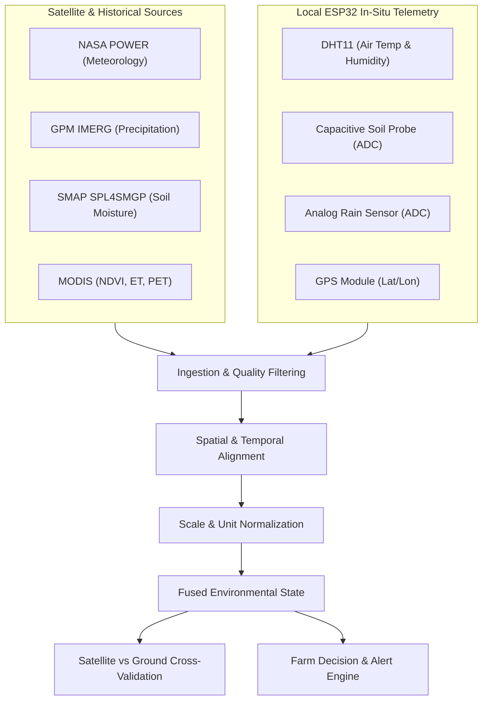

# 🔄 Data Fusion Engine

[← Back to Main README](../README.md)

---

CropWise AI's **Data Fusion Engine** unites top-down satellite observations with bottom-up in-situ IoT telemetry, delivering cross-calibrated ground truth for farm-level decision making.

---

## 🛰️ Top-Down vs. Bottom-Up Inputs

---

## 📐 Core Data Fusion Principles

1. **Preservation of Raw Provenance:**
   Raw telemetry (ADC integer counts, sensor voltages) is archived untouched alongside processed physical quantities.
2. **Dual Timestamping:**
   System records the device generation timestamp (`device_time`) and the cloud ingestion timestamp (`server_time`) independently to detect telemetry latency or offline buffering.
3. **Multi-Scale Spatial Reconciliation:**
   A single ground probe measures moisture in ~$10\text{ cm}^3$ of soil, while SMAP estimates represent a $9\times 9\text{ km}$ pixel. The engine interprets ground telemetry as a point anomaly detector within the macro satellite envelope, avoiding naive equivalence assumptions.
4. **Physical Calibration:**
   Analog wetness sensor voltages are converted to rainfall intensity only when paired with calibrated tipping bucket gauges; otherwise, they are categorized into discrete event classes (`Dry`, `Light Dew/Moisture`, `Active Rain`).

---

[← Back to Main README](../README.md) • [Next: IoT Hardware →](IOT_HARDWARE.md)
