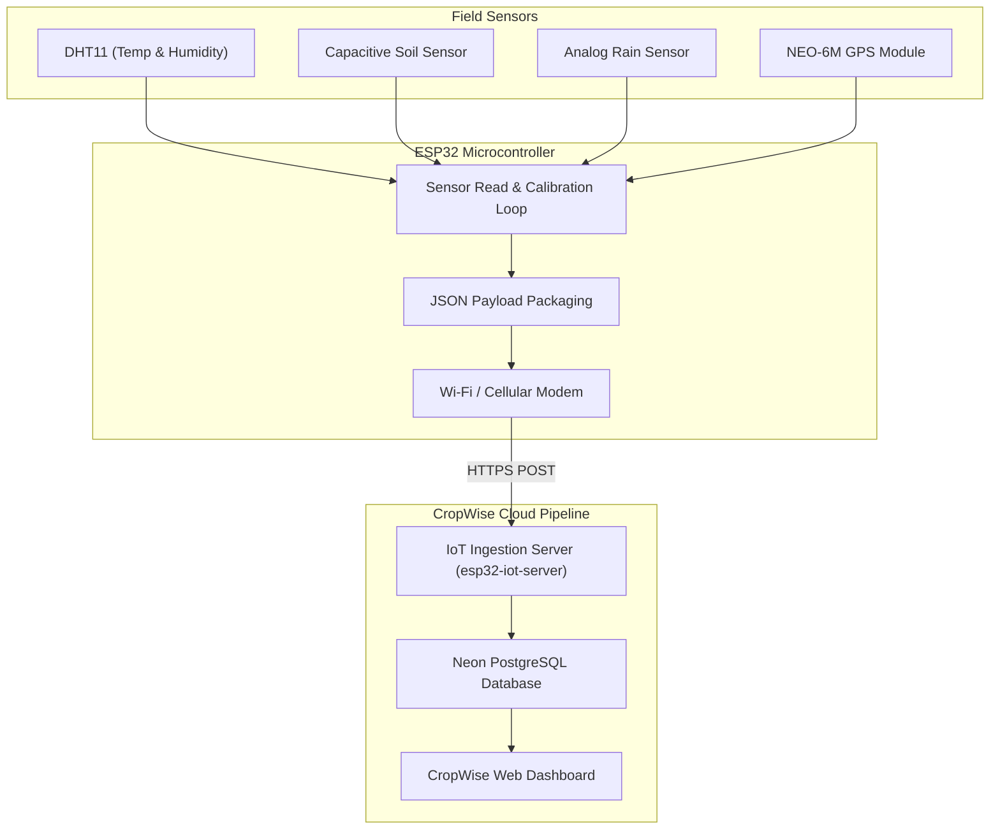

# 🔌 IoT Device & Hardware Integration

[← Back to Main README](../README.md)

---

CropWise AI pairs with a custom **ESP32-based telemetry node** deployed directly in agricultural fields. The node reports continuous ambient and soil readings to complement periodic satellite overpasses.

---

## 📷 Hardware Prototype

<!-- Hardware Prototype Photo Placeholder -->
```
┌─────────────────────────────────────────────────────────┐
│                                                         │
│               [ IoT Prototype Photo Frame ]             │
│        (Drop your hardware photo at assets/iot/)        │
│                                                         │
└─────────────────────────────────────────────────────────┘
```

---

## 🛠️ Hardware Bill of Materials (BOM)

| Component | Functionality | Interface / Protocol |
| :--- | :--- | :--- |
| **ESP32 DevKit V1** | Central MCU with 2.4 GHz Wi-Fi & Bluetooth | Microcontroller Core |
| **DHT11 Sensor** | Air temperature ($0–50^\circ\text{C}$) & Relative Humidity ($20–90\%$) | Single-bus Digital (GPIO 4) |
| **Capacitive Soil Probe v1.2** | Corrosion-resistant dielectric soil moisture measurement | Analog ADC (GPIO 32) |
| **Analog Rain Board** | Precipitation & wetness detection | Analog ADC (GPIO 35) |
| **NEO-6M GPS Module** | Geolocation coordinates (Latitude, Longitude, Altitude) | UART Serial (RX GPIO 16, TX GPIO 17) |
| **I²C 16x2 LCD** | Local field telemetry display | I²C Bus (SDA GPIO 21, SCL GPIO 22) |
| **2-Channel 5V Relay** | Automated irrigation pump & actuator triggering | Digital Output (GPIO 18, 19) |
| **Power Management** | 5V buck converter / Li-ion solar charging circuit | Regulated DC |

---

## ⚡ ESP32 GPIO Pinout Table

| Peripheral | ESP32 Pin | Type | Notes |
| :--- | :--- | :--- | :--- |
| **DHT11 Data** | `GPIO 4` | Digital I/O | Pull-up resistor recommended |
| **Capacitive Soil Sensor** | `GPIO 32` | Analog ADC1 | 12-bit ADC ($0–4095$) |
| **Rain Sensor Analog** | `GPIO 35` | Analog ADC1 | Input-only pin |
| **GPS Module RX** | `GPIO 16` | Hardware Serial 2 | Connects to GPS TX |
| **GPS Module TX** | `GPIO 17` | Hardware Serial 2 | Connects to GPS RX |
| **I²C LCD SDA** | `GPIO 21` | I²C Data | Standard ESP32 I²C pin |
| **I²C LCD SCL** | `GPIO 22` | I²C Clock | Standard ESP32 I²C pin |
| **Relay Channel 1** | `GPIO 18` | Digital Output | Active LOW / HIGH depends on module |
| **Relay Channel 2** | `GPIO 19` | Digital Output | Active LOW / HIGH depends on module |

> [!WARNING]
> ESP32 GPIO pins operate at **3.3V logic** and are **not 5V tolerant**. Ensure all 5V sensors use appropriate logic level shifters or voltage dividers before connecting to ADC pins.

---

## 📡 Hardware System Flowchart



---

## 📦 Sample Telemetry Payload

```json
{
  "success": true,
  "deviceId": "esp32-001",
  "temperature": 28.5,
  "humidity": 65.0,
  "soilMoistureRaw": 1840,
  "rainSensorRaw": 3200,
  "latitude": 23.8103,
  "longitude": 90.4125,
  "created_at": "2026-11-12T19:00:00.000Z"
}
```

---

[← Back to Main README](../README.md) • [Next: API Overview →](API_DOCUMENTATION.md)

