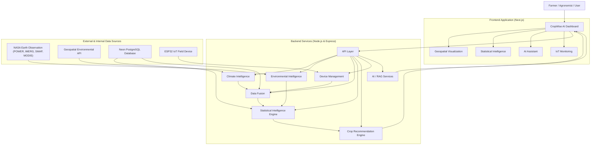
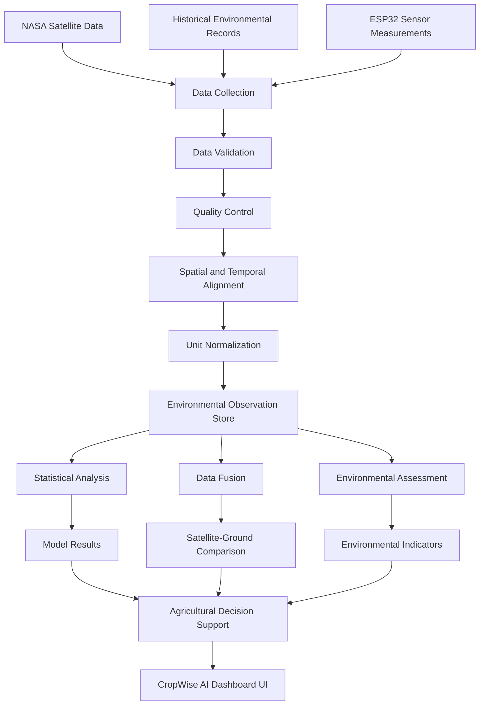

# 🏗️ System Architecture

[← Back to Main README](../README.md)

---

## 📌 Architecture Overview

**CropWise AI** follows a modular, decoupled architecture that connects frontend web applications, backend analytics services, Earth observation pipelines, statistical computing engines, AI assistant layers, and ESP32 IoT field nodes.

---

## 🔄 High-Level Architecture

The following diagram illustrates how user requests, telemetry streams, and satellite data flow through the platform:

---

## 🔬 Data Processing Pipeline

This pipeline validates, aligns, and normalizes satellite observations and IoT telemetry before feeding them into statistical modeling and agricultural decision support:

---

## 🧩 Architectural Modules

| Layer | Responsibility | Key Technologies |
| :--- | :--- | :--- |
| **Presentation Layer** | Responsive web dashboards, interactive maps, telemetry graphs, and AI chat. | Next.js 16, React 19, Tailwind CSS, TanStack Query, Mapbox GL |
| **Backend Core** | Business logic, authentication, geospatial parsing, and external API connectors. | Express 5, TypeScript, Prisma ORM |
| **Data Fusion & Stats Engine** | Multimodal data alignment, OLS regression, PCA, and K-Means clustering. | Node.js, Python statistical workflows |
| **Hardware & IoT Ingestion** | Ingesting real-time ambient and soil telemetry from distributed ESP32 nodes. | Express, PostgreSQL, WebSockets/REST |
| **Data Persistence** | Relational data, user configurations, historical timeseries, and device logs. | Neon PostgreSQL |

---

[← Back to Main README](../README.md) • [Next: Data Sources →](DATA_SOURCES.md)
