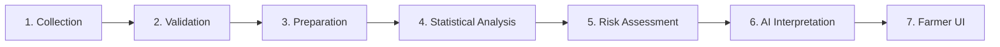

# 🔬 Data Workflow, Limitations & Roadmap

[← Back to Main README](../README.md)

---

## 🔄 End-to-End Processing Workflow

1. **Collection:** Streams satellite granules (NASA POWER, IMERG, SMAP, MODIS, Landsat) and in-situ IoT telemetry.
2. **Validation:** Identifies missing values, sensor dropouts, coordinate anomalies, and bad QA pixel masks.
3. **Preparation:** Normalizes units, standardizes timestamps to UTC, resamples temporal cadences, and computes composite indices.
4. **Statistical Analysis:** Runs OLS regression, Pearson/Spearman matrices, PCA transformations, and K-Means clustering.
5. **Environmental Assessment:** Computes drought, flood, thermal, and vegetative stress scores.
6. **AI Interpretation:** LLM pipeline crafts transparent, evidence-grounded rationales.
7. **Farmer UI:** Visualizes recommendations on responsive web and mobile interfaces.

---

## ⚠️ Challenges & Scientific Limitations

Transparent reporting of limitations is vital for trustworthy agricultural systems:

1. **Spatial Resolution Disparities:**
   Satellite observations represent spatial averages ($250\text{ m}$ for MODIS, $9\text{ km}$ for SMAP), whereas in-situ probes represent localized root-zone patches. Local microclimates may deviate from satellite averages.
2. **Temporal Cadence & Interpolation:**
   MODIS NDVI is a 16-day composite; daily records in the historical database reflect carrying-forward or interpolation between overpasses.
3. **Sensor Uncalibrated Counts:**
   Raw ADC outputs from analog rain and capacitive soil sensors represent relative dielectric / conductivity changes until calibrated against physical standard instruments.
4. **Historical Database Horizon:**
   The documented historical dataset spans 2024–2025 (2 years). While valuable for seasonal pattern recognition, long-term multi-decadal climate change assertions require 30+ year climatologies.
5. **Correlation vs. Causation:**
   Regression models establish statistical associations, not definitive biological causation. Recommendations should always be paired with agronomic field inspections.

---

## 🚀 Future Roadmap

- [ ] Expansion of historical database to 10+ years using NASA POWER archives.
- [ ] Direct integration of high-resolution Sentinel-2 (10m) multispectral imagery.
- [ ] LoRaWAN long-range low-power field connectivity for wide-area farm deployments.
- [ ] Offline-first Progressive Web App (PWA) with SMS/IVR voice advisory for non-smartphone farmers.
- [ ] Deep learning LSTM/Transformer models for 14-day soil moisture forecasting.
- [ ] Field parcel boundary auto-detection using high-resolution optical imagery.

---

[← Back to Main README](../README.md) • [Next: Demo Gallery →](DEMO_GALLERY.md)
